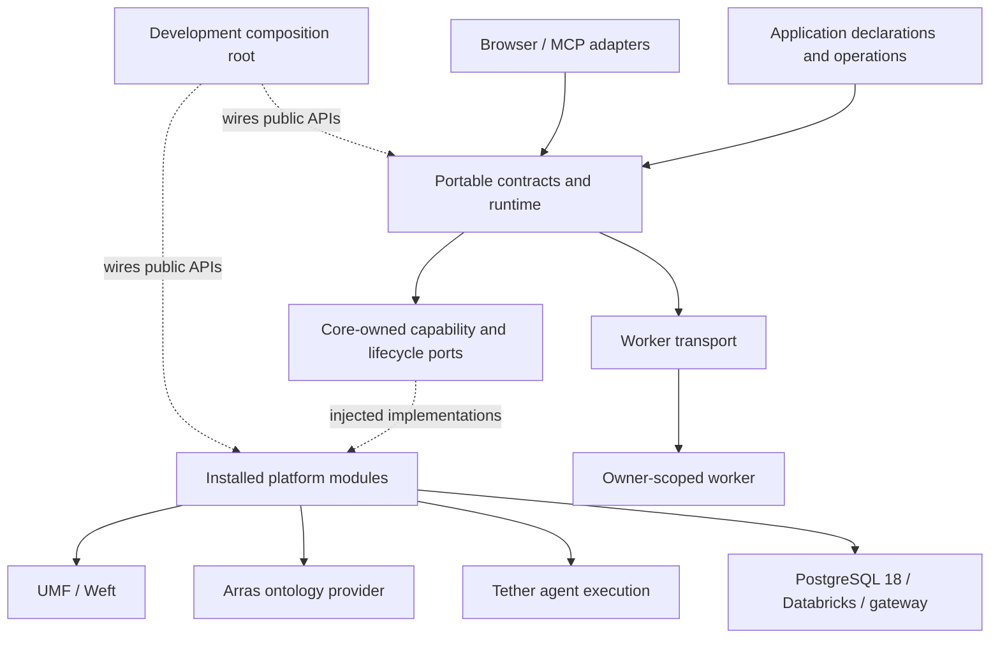
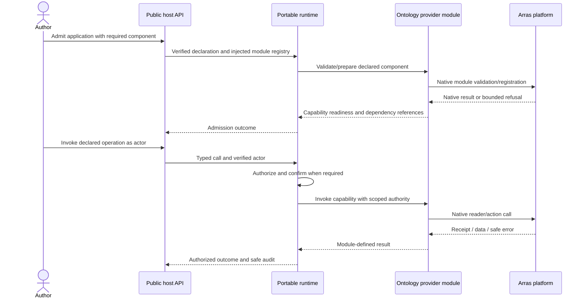

---
ddx:
  id: batten.architecture
  type: architecture
  activity: design
  authoring:
    home: repo
  links:
    - id: batten.prd
      kind: derived_from
    - id: batten.boundary-audit
      kind: informed_by
    - id: batten.concerns
      kind: informed_by
---

# Batten architecture and proposed module split

## Scope

Batten has a platform-neutral application core and independently installed
platform modules. This is the proposal for the owner's first review. It covers
PRD FR-1–44 and FR-46. The composition/hosting packet elaborates the owner-selected
next design slice; migration and product code still require build authorization. The [boundary audit](../00-discover/current-state-inventory-boundaries.md)
precedes this target model.

**Pure core has zero ontology-specific capabilities.** Its capabilities are:
declaration handling, admission, authorization, operation dispatch, component
lifecycle/dependencies, background-work coordination, confirmation, and audit.
These use generic component and capability contracts. They import no ontology
type, query language, relationship model, schema registrar, or ontology provider.

An ontology provider is a Batten platform module, just as a table or model
provider is. Application data and ontology schema remain native upstream meaning;
the core preserves their opaque versioned declarations and invokes the owning
module's validator. A required component with no suitable provider is refused.

## Packaged runtime and fleet responsibilities

The platform assembles selected module wheels, browser artifacts and their exact
upstream dependencies into a complete qualified runtime. Applications consume
that runtime without pip/npm installation. Independent module distribution is a
platform assembly boundary; it does not delegate dependency resolution to each app.
Deep declarative services and bounded public APIs reduce the behavioral variation
that fleet-wide upgrades must qualify.

Packaging owns cohort and application artifact identity; qualification tooling
checks affected application assertions, behavior coverage and required telemetry
against each candidate cohort. Admission verifies that required evidence matches
exact artifacts and host policy. Hosts enforce telemetry and capability use at
execution boundaries. Missing evidence or unobservable required outcomes cannot
silently qualify an upgrade. ADR-005 and CONTRACT-002 define these obligations;
exact evidence exchange and rollout automation require downstream contracts.

Shared hosts target hundreds of applications using common platform services.
Generic runtime/worker coordination enforces application and owner limits,
concurrency, fairness, revocation and lifecycle; providers enforce native resource
scope. Host diagnostics attribute outcomes and resource use to each application,
artifact and cohort. Operators own workload budgets and measured failure domains;
shared-process containment is for trusted first-party code and does not promise
hostile-code isolation or immunity to a process-wide failure.

Cross-application integration uses Batten's platform ontology through the Arras
provider: Application, ServiceInterface, ServiceExport, ServiceRequirement and
ServiceBinding. Shared business types remain independently governed UMF artifacts.
CONTRACT-009 separates semantic contracts, transport descriptors and deployment
resources; qualified graph, owner-published table/view, API and messaging exports
share discovery and resolution rules without inheriting each other's guarantees.

Host composition explicitly bootstraps the registry. Authenticated discovery runs
outside effect-free assessment and filters visibility before pagination or impact
expansion. The module supplies exact artifact-bound resolution evidence and generic
dependency edges; portable core sees opaque capabilities and lifecycle dependencies.
Core-only hosts may consume explicit bindings without loading ontology packages.

Only host-approved bindings connect an exact consumer requirement to an admitted
export and deployment resource. Every use checks current caller/application
authority, target scope, grants and binding revisions. Discovery, graph links and
shared storage confer no authority; raw cross-application connections remain
forbidden. Contract/deployment changes require reassessment, with no automatic
provider fallback or replay of uncertain effects. Exact Arras async/snapshot and
transport delegation profiles require qualification before source work (ADR-013).

Cohort rollout must preserve application and durable-state compatibility. Retaining
an accepted runtime allows upgrade withholding; reverting code cannot reverse
schema changes or completed external effects. Migration and production rollout
remain separately authorized operations.

## Level 1: System Context

| Element | Type | Purpose | Protocol |
|---------|------|---------|----------|
| Application author | User | Declare native structures, behavior, and UI | Installed SDK/CLI |
| Host integrator/operator | User | Supply platform modules, identity, configuration, and approvals | Public host API |
| UMF and Weft | Platform library | Native schemas, compiler, typed access, query compilation | Public versioned library APIs |
| Arras | Platform library | Ontology provider and native reader/action semantics | Public library API |
| Tether | Platform library | Agent execution and durable session semantics | Public async API |
| UMF saga vocabulary/executors | Upstream semantics | Saga declaration and qualification; Batten supplies binding only | Exact qualified upstream profile |
| ux-builder | UI platform | Design-first artifacts, components, tokens and audits | Optional public adapter and pinned artifacts |
| Databricks, Lakebase, model gateway | Platform services | Governed data, storage, external jobs, models | Owning adapter APIs |
| Browser and MCP client | User surface | Reach declared operations and resources | Host bridge/MCP |

### Attributed commands and system interactions

Command Query Responsibility Segregation (CQRS) is the default public operation
model. Generic dispatch enforces command/query intent, permission, confirmation
and trusted invocation context. UMF retains action and transaction semantics;
CQRS selects neither event sourcing nor separate read/write storage. Declared
exceptional SQL and provider maintenance remain governed and audited boundaries.

The runtime binds initiating user, effective authority, delegation and causal
identity once at trusted ingress. Workers, queues, schedules, agent tools and
cross-application calls preserve that origin while rechecking current authority.
Adapters instrument every database, messaging, AI gateway, storage, search and
other system interaction through OpenTelemetry (OTel), using native attribution
where supported and reporting precise gaps where it is not. CONTRACT-001 owns
the propagation and audit rules; native clients stay in their owning modules.

Portable contracts/core remain stdlib-only. Injected diagnostic protocols carry
context to host/provider instrumentation; concrete OTel SDK/exporter dependencies
belong to the selected host/adapters and require cohort qualification. Durable
audit is independent of sampled traces. Audit storage, retention, access, loss
handling and exact OTel mappings require focused contracts before source work;
no cross-service atomic audit guarantee follows from this architecture.

## Level 2: Container Diagram

| Container | Technology | Responsibilities | Communication |
|-----------|------------|------------------|---------------|
| Embedding host | Python 3.11+; optional FastAPI/ASGI | Composition, admission, dispatch, lifecycle | Public core API and injected ports |
| Worker | Python 3.11+; OS process containment | Owner-scoped application execution | Bounded capability-scoped messages |
| Optional ux-builder adapter | Preserve upstream design artifacts; bind controls/context through portable client | CONTRACT-005 | Public browser client and pinned public ux-builder packages | Core Python imports, copied design system/blueprint, shell internals |
| Browser client | Browser JavaScript; TypeScript build via Bun | Permission-contained screen/view bridge | Host-owned messages and operation calls |
| Local development supervisor | Python 3.11+; uv; PostgreSQL 18 helper | Installed-artifact author workflow and cleanup | Public host/platform APIs only |
| Application state | PostgreSQL 18 or Lakebase PostgreSQL 18 | Tables, durable schedules and lifecycle state | Owned native adapter |
| External compute/resources | Databricks APIs and configured gateway | Warehouse, files/search, jobs/pipelines, models | Owning platform module |

Solid arrows show logical interaction, not a license for runtime imports from
core to adapters. Dashed arrows show composition-owned injection.

## Module Boundaries

**Source Applicability**: source; Batten owns independently written Python modules
and a browser client. Paths below are proposed import packages, not assertions
that source files already exist. The namespace root performs no eager re-exports.

`C` means `batten.contracts`; `R` means `batten.runtime`. Exact import roots,
public-surface checks, and failure rules are in CONTRACT-002.

| Module | Responsibility / Owned Types | Public API | Allowed Dependencies | Forbidden Dependencies |
|--------|------------------------------|------------|----------------------|------------------------|
| `batten.contracts` | Actor, component/capability references, operation declarations, generic outcomes, provider protocols | Declaration/value types and provider SPI, CONTRACT-001 | Python stdlib only | All other Batten modules, frameworks, native drivers, ontology/data types, host applications |
| `batten.runtime` | Generic admission, permission decisions, dispatch, dependency lifecycle, queue coordination, confirmation, audit policy | `create_host`, `Host`, `HostServices`, CONTRACT-001 | C and stdlib | Every adapter, testing/tooling, ontology-aware code, concrete HTTP/DB/model types |
| `batten.packaging` | Wheel metadata, artifact verification, digest, dependency checks, CLI, explain/docs | `inspect_artifact`, `verify_artifact`, author command surface | C, stdlib, `packaging`; uv/pytest as explicit build/test tools | Runtime construction, platform adapters, legacy source imports, runtime package installation |
| `batten.testing` | Portable doubles, outcome recorders, reusable public-port conformance | `TestHost`, doubles and conformance runners | C, R, stdlib; pytest only at test-runner boundary | Production adapters, host internals, compiler or SQL simulation claiming native equivalence |
| `batten.umf` | Native application/module/UI UMF validation, metadata projection, typed procedural and saga-reference binding | CONTRACT-003 validation adapter; upstream native targets | C and public UMF APIs | Copied envelope/action/saga compiler, concrete saga engine, host internals |
| `batten.hosting` | Typed profile resolution, trusted factory composition, ownership/placement binding | CONTRACT-004 `start_plan` | C, R; selected public factories injected; settings dependencies at composition | Eager unselected providers, private host discovery, automatic installs |
| `batten.tables` | Native UMF component binding, upstream compiler/typed-access integration | `TableComponent`, `TableProvider`, native artifact validation | C and public UMF/Weft APIs | Copied compiler/planner/parser/RLS emitter, native driver, legacy-format adapter |
| `batten.workers` | Transport, signed authority/owner envelope, process supervision, limits and shutdown | `WorkerExecutor`, `WorkerPolicy`, lifecycle interface | C, R, stdlib/OS interfaces | Host app internals, database credentials, platform SDKs, automatic service construction |
| `batten.postgres` | PostgreSQL 18 execution, owned/borrowed sessions, identity/pools, durable state, messaging provider and native migration execution | `PostgresServices`, `ConnectionSource`, CONTRACT-007 provider, explicit maintenance API | C, public `batten.messaging` in messaging provider, stdlib, `psycopg` | Databricks/gateway SDKs, upstream compiler duplication, UI, host app internals |
| `batten.messaging` | Scoped channels/subscriptions, payload profile references, settlement protocols and validation | CONTRACT-007 `Channel`, `Subscription`, `Payloads`, `for_resource`, `payloads` | C and stdlib; codecs/providers injected | Runtime internals, native drivers, broker SDKs, copied UMF codecs/action engines, host app internals |
| `batten.lakebase` | Lakebase endpoint/role/credential integration and qualification | `LakebaseAuthority`, public authority/session factory | C, stdlib, Databricks SDK | Generic SQL executor duplication, host environment reads, other adapter internals |
| `batten.storage` | Scoped byte-object protocols, keys, limits and local managed filesystem provider | CONTRACT-006 `ObjectStore`, `for_resource`; `batten.storage.local` factory | C and stdlib; local imports own public protocol | Runtime/other adapters, vendor clients, ontology/data types, host internals |
| `batten.platform` | Generic asset declarations, validation, deployment protocols and receipt values | CONTRACT-010 provider protocols and values | C and stdlib | Runtime, vendor SDKs, native bundle parsers, model/DDL compiler, host internals |
| `batten.databricks` | Warehouse choice, UC files/search/grant reporting, jobs/pipelines, lineage, artifact store and native deployment adapter | `DatabricksServices`, module-specific clients; `batten.databricks.platform` | C, public `batten.storage` and `batten.platform`, stdlib, Databricks SDK; admitted CLI through operator tooling | PostgreSQL execution, model/session loop, host app internals |
| `batten.gateway` | Gateway completion/embedding translation, aliases, budgets, attribution | `GatewayModels`, configured client factory | C, stdlib, `httpx` or injected supported client | Agent loop, concrete model choice in declarations, unrelated platform adapters |
| `batten.arras` | Ontology validation/reads/actions; Batten platform model, service resolution evidence, links, receipts and retirement dependencies | `OntologyProvider`, module-owned ontology client/types | C and public Arras/UMF APIs | Core ontology special cases, private store access, duplicate ontology engine |
| `batten.tether` | Agent/session integration and operation-to-tool binding | `AgentProvider`, session/tool integration | C and public Tether APIs | A second agent loop, private Tether modules, concrete storage owned by another adapter |
| `batten.asgi` | HTTP and FastAPI route/gate mapping | `create_app`, route adapter and actor binding | C, FastAPI/Starlette/ASGI types | Concrete data/model providers, host app construction/private dependencies |
| `batten.mcp` | Operation-derived tools and resources; local stdio transport | `serve_stdio`, tool/resource adapters | C and public MCP SDK | Admin-tool exposure, private host discovery, remote-token forwarding, agent-loop ownership |
| `batten.dev` | Local composition, typed file config, fake identity, PostgreSQL lifecycle, supervisor/logging | `run_project`, `stop_project`, `project_status` | Public APIs of the preceding modules; uvicorn, Pydantic Settings, PostgreSQL 18 helper | Any private API, importing a consuming application, source-checkout discovery, new environment names |
| Browser client | Frame calls, navigation/focus, views and downloads; optional host-side bridge implementation | `AppHost` and host bridge API | Browser APIs; TypeScript/Bun/Playwright for build/verification only | Python objects, shell internals, runtime Bun/Node APIs, arbitrary network credentials |

**Integration Owners**: UMF application/saga metadata → `batten.umf`;
ux-builder → optional browser adapter; typed host profiles → `batten.hosting`;
UMF/Weft → `batten.tables`; PostgreSQL →
`batten.postgres`; Lakebase authority → `batten.lakebase`; Databricks resources →
`batten.databricks`; models → `batten.gateway`; ontology → `batten.arras`;
agent sessions → `batten.tether`. Each translates provider representations at
its public boundary. Core component payloads preserve unknown extension content;
they do not become a competing schema language.

**Construction Policy**: the embedding host's composition root, or `batten.dev`,
constructs concrete modules. For example, it injects Lakebase authority into the
PostgreSQL service and native compiled artifacts into its execution port; neither
adapter imports the other's implementation. Core constructs no concrete adapter.
Module exports and required capabilities are registered explicitly by the host.
Application declarations cannot install or replace a privileged platform provider.
`TestHost` wraps the real portable runtime with doubles; it does not reimplement
admission, permissions, or dispatch as a second test-only host.

**Boundary Check**: the specified entry point is
`uv run python scripts/check_boundaries.py --base HEAD`, with CONTRACT-002's
per-module allowlists, public-export checks, and negative controls. It will be
implemented only after this review. Documentation validation is not evidence
that an import gate already executes; dependent source work requires that gate.

## Deployment

| Component | Infrastructure | Instances | Scaling | Backup / Recovery |
|-----------|----------------|-----------|---------|-------------------|
| Local host/supervisor | Loopback process and PostgreSQL 18 helper | One project session; identity fixtures explicit | Operator-set worker and resource bounds | Persistent project database; awaited shutdown and stale-process reconciliation |
| Embedded host | Operator's Python/ASGI service, including Databricks Apps | Host-owned topology; no invented fleet size | Host/operator policy | Host-owned durable state/backup; qualified restart/recovery checks |
| Worker | Owned child process | Per application/owner scope within explicit caps | Demand, idle retirement, circuit/backoff | Revoked capabilities; stop/drain; generation-aware restart |
| Browser client | Host-served approved resources | Per user view | Host HTTP service | Re-read/reverify immutable artifact; no durable browser authority |
| Platform services | PostgreSQL 18, Lakebase, Databricks, gateway | Platform-owned | Platform-owned limits | Native backup/recovery and lineage, verified for each claimed cohort |

The SDK does not provision operator infrastructure. No deployment, remote creation,
dependency installation, or operational credential access is part of this review.

## Platform asset deployment

CONTRACT-010 and ADR-012 extend application delivery with optional generic
`batten.platform`. App-managed native packages, external release/output contracts
and mixed dependencies share one declaration boundary. Core continues to see
capability metadata and generic admission findings, without asset or vendor types.
Host composition injects validator/provider services; operator tooling calls the
provider's read-only planning, explicit apply and reconciliation interfaces.

Package source closure is part of the immutable application inventory. Trusted
build evidence covers native source, generated artifacts and remote code dependency
closure. Pure assessment never executes native build hooks. Live planning binds
environment state, toolchain, ownership and dependency receipts into the reviewed
plan. Native apply has durable operation identity and preserves partial/unknown
outcomes. The deployment service must retain state and serialize conflicting
ownership changes; application replicas do not independently reconcile resources.

The first adapter target is Databricks Declarative Automation Bundles, formerly
Databricks Asset Bundles. `batten.databricks.platform` owns bundle format validation,
CLI/API invocation, deployment state, target/workspace mapping, native substitutions,
Unity Catalog identities and permission inspection. Version-pinned native packages
may contain jobs, pipelines and supported catalog resources. Generic declarations
name interface contracts and opaque outputs, never universal vendor resource enums.

Table lifecycle is explicit: pipeline outputs require separately authorized runs
and output verification; ordinary tables use reviewed native creation/migration
artifacts through qualified tooling. No generic `resources.tables` support or
portable model-to-DDL translation is inferred. Existing UMF/Weft tooling retains
its own qualified target profiles; PostgreSQL support does not establish Delta
or Unity Catalog support. Unsupported resource kinds or semantics refuse.

External producers publish exact release/output contracts. Operators supply
environment-specific resource bindings and trusted receipts; selected native
lookups may assist resolution but establish neither compatibility nor ownership.
The consumer inspects grants/readiness and cannot deploy or adopt producer assets.
Databricks App resource attachments bind access to existing resources; they do
not replace creation, deployment ordering or output readiness verification.

Runtime preparation checks current receipt, access and contract evidence.
Start/reload never deploys, migrates, initializes or grants. Client close and app
removal preserve persistent assets by default, with one declared lifecycle owner
and separately approved destruction that checks dependents. Deployer authority
and runtime authority remain separate. Vendor SDK/CLI qualification, provider
feature limits, state retention and readiness budgets require observed evidence.

Primary provider evidence: [bundle configuration](https://docs.databricks.com/aws/en/dev-tools/bundles/settings),
[supported resources](https://docs.databricks.com/aws/en/dev-tools/bundles/resources),
[variables and lookups](https://docs.databricks.com/aws/en/dev-tools/bundles/variables),
and [app resource bindings](https://docs.databricks.com/aws/en/dev-tools/databricks-apps/resources).
Documentation inspection establishes candidate mechanisms only; exact toolchain
and native behavior remain qualification obligations.

## Required local-development composition

The local composition root supplies explicit stub authentication and one shared
PostgreSQL 18 pgserver instance. Truss and direct UMF table bindings borrow that
instance through separate owner/principal/resource bindings; sharing a server
neither merges storage ownership nor supplies cross-resource atomicity.

The local Tether module uses a host-configured model API through its public
provider boundary. Typed file configuration binds the endpoint/profile and scoped
credential reference; the application declares capabilities. A scripted provider
is an explicit test choice, never a silent fallback from a failed live endpoint.
CONTRACT-004 owns lifetime, permission and no-reset obligations. Generic agent
clients' shell/filesystem tools are not implicitly application capabilities.

## Composition and host profiles

CONTRACT-003 separates immutable application requirements, installed module
metadata and effect-free assessment. CONTRACT-004 binds the result to local,
standalone or embedded hosting with independent in-process, child-process or
qualified remote-worker placement. Providers/resources are selected explicitly;
application intent does not change between profiles. Remote placement remains
unsupported until its transport and recovery obligations are qualified.

The public browser client is portable. CONTRACT-005’s optional ux-builder
adapter preserves original blueprint/assets and maps controls to native targets.
A headless closure imports no UI packages. `batten.umf` converts exact native
validation results to core metadata; generic core does not parse ontology or saga
semantics. `batten.hosting` builds services through a trusted catalog of selected
public factories, after plan verification. No native saga engine is selected.

### Semantic interaction composition and local implementation

The authoring progression is manifests/UMF/extensions, then local Python and/or
TypeScript, then exceptional platform dependencies. CONTRACT-003 owns dependency
admission and CONTRACT-005 owns control/renderer metadata. ux-builder owns semantic
control definitions and composition slots; Batten binds their data/actions and
preserves source artifacts. No second layout or workflow engine enters core.

The operation/outcome boundary is independent of presentation. Browser and terminal
clients implement separate scoped host contexts; the existing browser client keeps
its runtime/import restrictions. Renderer selection adds an independent presentation
choice to capability, hosting and placement. Terminal client packaging and runtime
remain open until a qualified dependency-free implementation or approved platform
extension is selected. No new framework is chosen here.

Local detailed controls are application code, not privileged provider modules.
They use supplied primitives, ordinary language facilities and explicitly exposed
platform APIs. A new dependency changes the platform closure and needs explicit
owner approval and host admission. Existing platform modules keep their reviewed
dependencies. Headless applications import neither graphical nor terminal UI code.

## Data Flow

Illustrative contract flow, not an observed Batten runtime:

Core can order and retire providers through generic dependency references. It
does not inspect type relationships; the ontology module supplies the applicable
dependency/refusal result. Failed required preparation prevents readiness.

## Quality Attributes

| Attribute | Target | Strategy | Verification |
|-----------|--------|----------|--------------|
| Ontology independence | Zero ontology-specific core imports or vocabulary-driven branches | Module-owned schemas and generic capability/dependency contracts | Import checks plus semantic review of core public types and dispatch |
| Host independence | Zero private consuming-host imports | Public lifecycle and injected services | Installed-artifact-only host and negative import controls |
| Shape | CONTRACT-002 ceilings only decrease | Global edit/local/hook/CI gate | Actual over-limit and forbidden-edge controls |
| Test discipline | First reviewed measured suite establishes ceiling; then only decreases | One primary test per behavior, no disguised growth | Function/case census and coverage review |
| Behavior preservation | Every FR has an observable acceptance path | Native/double/worker/browser/deployed evidence kept distinct | Scoped qualification matrix and consumer outcomes |
| Latency/recovery | Targets supplied by Erik LaBianca and platform operators | Measure work and native plans before selecting budgets | No invented service-level objective or unsupported recovery promise |

## Decisions and Tradeoffs

| Decision | Direction | Rationale | Follow-up |
|----------|-----------|-----------|-----------|
| ADR-001 | Platform modules around an ontology-neutral core | Keeps platform semantics out of admission/dispatch | Review module/public API map |
| ADR-002 | Native upstream UMF and typed access | Settled owner ruling; no duplicate compiler | Qualify complete upstream lifecycle/policy matrix |
| ADR-003 | Core plus separate platform/tool/development wheels | Install and test actual dependency closures | Review distribution/cohort policy |
| ADR-004 | One public asynchronous host API | Replaces private construction/config/database/logging reach | Review CONTRACT-001 |
| ADR-005 | SDK series independent of host release | Declare compatibility without coupling every release | Review capability and release matrix |
| ADR-006 | Typed files authoritative, environment fallback only | Settled owner ruling | Review existing-host fallback mapping later |
| ADR-007 | Shape and test-count ratchets | Prevent growth from erasing modularity | First executable gate slice after review |

Owner decisions remain in `../01-frame/decision-points.md`. An ontology-provider
module is the proposed shape; special application-plugin privileges, host identity
exceptions, and storage exemptions are not inferred from that shape.

## Object storage boundary

[CONTRACT-006](contracts/CONTRACT-006-object-storage.md) owns the optional storage
interface. [ADR-010](adr/ADR-010-scoped-object-storage.md) records module ownership.
Local managed filesystem and Databricks Volumes are the first backend pair. The
composition root supplies roots and authority; applications receive scoped handles
with relative keys. Core treats the storage capability as opaque. Neither shared
PostgreSQL placement nor UMF action binding supplies atomicity across bytes and rows.

## Messaging boundary

[CONTRACT-007](contracts/CONTRACT-007-messaging.md) owns named channels, durable
subscriptions, exact UMF payload profiles and explicit delivery settlement.
[ADR-011](adr/ADR-011-postgres-first-messaging.md) selects the first PostgreSQL 18
provider. Its `batten.postgres.messaging` adapter owns logged messages, subscription
deliveries, deduplication and retained settlement records. Short claim transactions
end before application handlers execute. The composition root injects trusted
connection/authority and separately qualified codecs through public protocols.

Generic runtime coordinates the existing durable-work service using admitted
provider handles; messaging adds no second scheduler or saga executor. Declared
operations still enter through `Host.invoke` with current authorization and required
confirmation. Message headers convey correlation, never operation authority.
Future broker adapters must satisfy an explicit capability profile; no native
offset/queue URL enters application APIs. UMF schemas define business payloads;
no new messaging vocabulary or universal instance codec is assumed.

## Semantic verification and migration

Upstream model/action and ux-builder definitions own semantic meaning. Batten's
author tooling must derive an executable test model from pinned intent, UI/hook
composition and effective use-case refinements. It must generate CLI coverage and
property-based end-to-end suites for every default fully declarative construct.
The generator must remain outside pure admission assessment and portable runtime;
no second UMF compiler or UI engine is introduced.

The test model supplies permitted transitions, invariants and expected outcomes;
qualified CLI and real renderer/host/provider adapters exercise implementations.
Changing a refinement regenerates both inputs and expectations. An independent
semantic oracle and known-broken adapter controls must detect a semantic defect;
comparing an implementation only with itself cannot establish conformance.
Generated properties replay across candidate platform bindings to gate migration.
UI rendering and interaction still need real-client observations alongside CLI
access to every semantic behavior. Missing required coverage prevents qualification.

Results must bind exact application/model/refinement/cohort inputs and preserve
seeds, generated traces, minimized counterexamples, coverage and exploration bounds.
Fully declarative includes hooks whose behavior is expressed in the semantic model;
an arbitrary code reference is insufficient. Exact upstream oracle/generator,
CLI and evidence interfaces require contracts before dependent source work.
